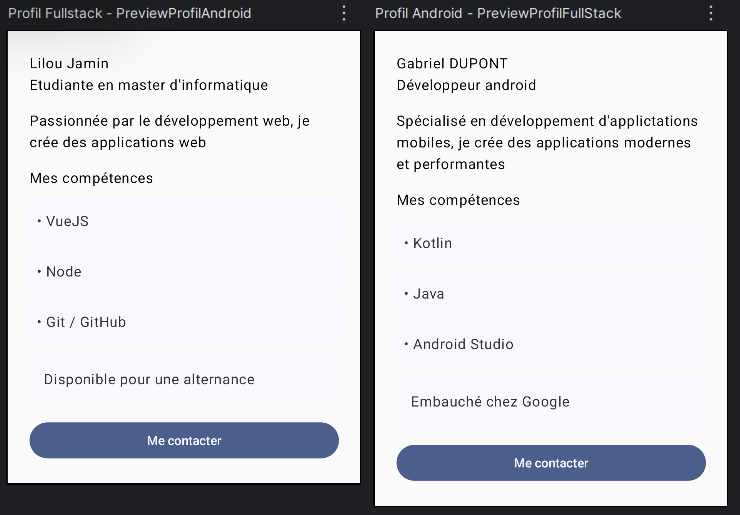
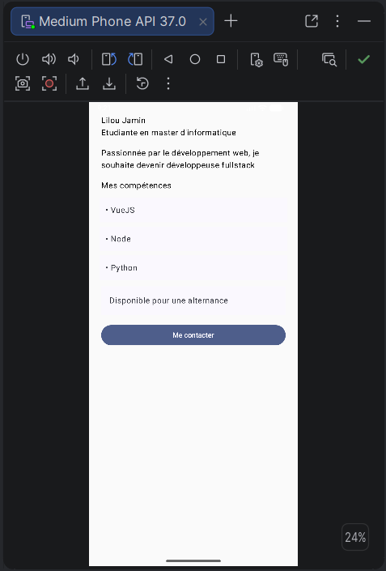

# Profil développeur Compose

## Description
Ce projet a été fait dans le cadre du cours de développement Android avec Jetpack Compose.
Le but était de créer une petite application qui affiche le profil d'un développeur. On y retrouve son nom, son métier, une petite description, ses compétences et sa disponibilité. J'ai aussi ajouté un bouton pour le contacter et une zone cliquable.

## Notions Compose utilisées
- fonctions @Composable
- passage de paramètres entre les composables
- création de composants réutilisables
- utilisation de Modifier et chaînage de plusieurs modifiers
- gestion des espaces avec padding
- organisation des éléments avec Column
- utilisation de Text, Surface et Button
- gestion des clics avec des callbacks
- utilisation de clickable
- accessibilité avec semantics, contentDescription et Role.Button
- création de previews avec @Preview

## Organisation du code

J'ai séparé mon interface en plusieurs composables pour éviter de tout mettre dans une seule fonction et que ce soit plus simple à comprendre.

 Composable : rôle 
 EcranProfil : c'est l'écran principal il envoie les infos du profil 
 FicheProfil : regroupe les différents éléments de la fiche 
 EnteteProfil : affiche le nom et le métier du développeur 
 DescriptionProfil : affiche la description du profil 
 CompetenceProfil : permet d'afficher une compétence 
 DisponibiliteProfil : affiche la disponibilité avec une zone cliquable 
 ActionProfil : affiche le bouton pour contacter 

## Explications
### 1. Quels composables avez-vous créés ?

J'ai créé 7 composables en tout. J'ai séparer les différentes parties de la fiche plutot que de tout mettre dans le même composant. Comme ça le code est plus facile à lire et on peut réutiliser certaines parties.

### 2. Quel composable représente l'écran principal ?

C'est EcranProfil qui représente l'écran principal. Il récupère les infos du développeur et les passe à FicheProfil qui s'occupe ensuite d'afficher les différents éléments

### 3. Où utilisez-vous un padding externe ?

J'utilise un padding externe dans FicheProfil quand j'appelle DisponibiliteProfil avec Modifier.padding(8.dp).
Ça permet de mettre un peu d'espace autour du composant pour qu'il ne soit pas "collé" aux autres 

### 4. Où utilisez-vous un padding interne ?

Dans DisponibiliteProfil, j'ai mis un Modifier.padding(16.dp) sur le Text qui se trouve dans la Surface, ça permet que le texte ne soit pas directement collé aux bords de la surface et que ce soit plus lisible.

### 5. Quel composant reçoit un callback ?

Les composables ActionProfil et DisponibiliteProfil reçoivent un callback onClick: () -> Unit
Le principe c'est que quand on clique dessus, le composant prévient le parent qu'il y a eu un clic. Par contre il ne décide pas lui même de ce qui doit se passer

### 6. Quelle information d'accessibilité avez-vous ajoutée ?

J'ai utilisé contentDescription dans DisponibiliteProfil pour donner une description de la zone cliquable, notamment pour les lecteurs d'écran. J'ai aussi ajouté Role.Button pour indiquer que cette zone fonctionne comme un bouton. Pour le bouton de contact j'ai utilisé directement Button car il possède déjà des fonctionnalités d'accessibilité de base.

### 7. Pourquoi vos composants peuvent-ils être considérés comme réutilisables ?

Mes composants sont réutilisables car les informations sont passées en params au lieu d'être écrites directement dans chaque composant.Par exemple, enteteProfil peut afficher plusieurs noms et métiers différents sans avoir besoin de modifier son code. Pareil pour CompetenceProfil qui peut afficher n'importe quelle compétence. 
J'ai aussi ajouté modifier: Modifier = Modifier dans mes composables pour pouvoir changer leur placement depuis le composant parent.

## Resultat final de l'application

